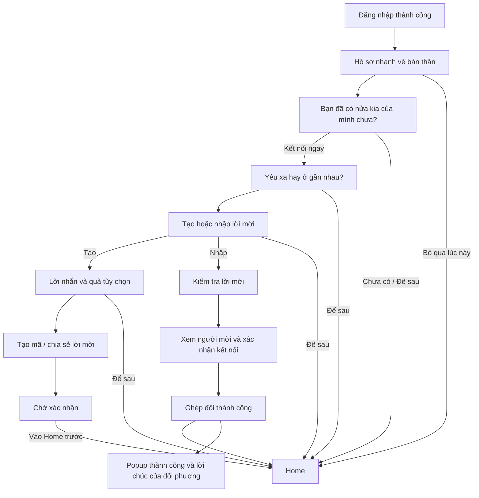

> **Quyết định triển khai ngày 2026-10-17:** đã gỡ toàn bộ service mô phỏng nghiệp vụ local khỏi mobile. Auth/invite/profile dùng API thật; các feature chưa tích hợp hiển thị chưa khả dụng. Setup local, gift local, popup ghép đôi local, outbox và cross-device chưa được coi là triển khai. Xem [bản trạng thái và kế hoạch backend](BACKEND-FIRST-CLEANUP.md); ghi chú này thay thế các mô tả local runtime cũ bên dưới.

# Flamee — luồng sau đăng nhập và ghép đôi tùy chọn

Ngày: 2026-10-11; cập nhật auth, entry route và invite backend 2026-10-14. Trạng thái: create/preview/revoke/accept invite trên mobile đã gọi backend; creator polling mỗi 5 giây khi app foreground. Migration giao dịch atomic nằm tại `backend/migrations/20261014_invite_flow.sql` và phải được review rồi áp dụng lên Supabase trước khi kiểm tra cross-device. Chưa xác nhận device E2E.

### Contract invite backend ngày 2026-10-14

- Mã gồm đúng 6 ký tự chữ hoa hoặc số, hiệu lực 72 giờ; tạo lại hủy mã pending cũ.
- `POST /couple/invite-code`, `GET /couple/invite-code`, `DELETE /couple/invite-code` lần lượt tạo, đọc và thu hồi mã của user hiện tại.
- `POST /couple/validate-invite` trả preview người mời nhưng không ghép đôi. `POST /couple/accept-invite` ghép đôi bằng PostgreSQL RPC có khóa hàng và transaction.
- Client xử lý riêng các trạng thái `invite_not_found`, `invite_expired`, `invite_cancelled`, `invite_used`, `self_invite`, `already_paired` và `inviter_already_paired`.
- Dữ liệu server và `user.couple_id` là bằng chứng ghép đôi. Gift/lời chúc local không thuộc contract backend này và đã được bỏ khỏi bước xác nhận server-backed.

Tài liệu này thay thế yêu cầu bắt buộc hoàn tất onboarding/ghép đôi trước khi vào Home trong mục 2 và 8 của [spec local](FLAMEE-LOCAL-MAINFLOW-SPEC.md). Kiến trúc feature-owned, ranh giới local/production và privacy vẫn áp dụng.

### Quyết định entry sau đăng nhập ngày 2026-10-14

- Kết quả login/register từ backend là nguồn quyết định entry ban đầu. `user.couple_id` có giá trị đi thẳng tới Home; `user.couple_id` rỗng đi tới màn tạo/nhập mã mời.
- Tiến độ setup local không còn chặn entry sau đăng nhập. Hồ sơ nhanh và các tùy chọn chăm sóc vẫn có thể cập nhật sau, nhưng không được đưa session hợp lệ quay lại Login hoặc ép qua onboarding trước màn lời mời.
- Khôi phục session khi app mở không được ghi kết quả cũ đè lên một session vừa được tạo bởi login/register trong lúc bootstrap còn chạy.
- Quyết định này thay thế các đoạn dưới đây nếu chúng còn mô tả “login lần đầu → hồ sơ nhanh” như một entry bắt buộc.

## 1. Luồng chính

Popup hiển thị trên Home sau khi membership đã cập nhật. Người gửi đang ở Home cũng nhận popup khi ứng dụng nhận được kết quả ghép đôi của mình.

## 2. Các bước và hành động

| Bước | Nội dung | Hành động chính | Đường bỏ qua |
|---|---|---|---|
| Hồ sơ nhanh | Cập nhật thông tin cơ bản về bản thân; giữ form ngắn | Lưu và tiếp tục | Vào Home, có thể cập nhật sau ở Cá nhân |
| Hỏi về nửa kia | “Bạn đã có nửa kia của mình chưa? Kết nối với cậu ấy ngay nhé.” | Kết nối ngay | Chưa có / Để sau → Home |
| Khoảng cách | Hai lựa chọn: Yêu xa / Ở gần nhau | Chọn và tiếp tục | Để sau → Home |
| Cách kết nối | Tạo lời mời / Nhập lời mời | Đi vào nhánh đã chọn | Để sau → Home |
| Soạn lời mời | Lời nhắn, quà kèm mascot hoặc ảnh đều tùy chọn | Tạo lời mời rồi chia sẻ | Bỏ phần quà vẫn tạo được; rời toàn bộ bước → Home |
| Chờ | Người gửi thấy lời mời còn hiệu lực và trạng thái chờ xác nhận | Chia sẻ / xem lại lời mời | Vào Home trước; lời mời vẫn còn hiệu lực |
| Nhận | Kiểm tra mã/link, xem người mời, lời nhắn và quà | Xác nhận kết nối | Để sau → Home, chưa ghép đôi |
| Thành công | Popup thông báo ghép đôi và lời chúc của đối phương | Đóng popup / xem quà | Đóng để tiếp tục dùng Home |

Mọi bước thiết lập đều có đường vào Home. Bỏ qua không tự điền hồ sơ, chọn khoảng cách, tạo lời mời hoặc chấp nhận lời mời. Theo quyết định trực tiếp ngày 2026-10-14, flow hiện tại không hiển thị trang Điều khoản/Chính sách quyền riêng tư và không tự ghi consent. Care preferences hiện có chuyển thành phần cập nhật tùy chọn sau đó; không chặn luồng mới.

## 3. Người gửi

1. Chọn Tạo lời mời, thêm lời nhắn/quà nếu muốn, tạo mã rồi chia sẻ.
2. Membership ở trạng thái chờ, không có partner giả và chưa được coi là đã ghép đôi.
3. Có thể vào Home ngay. Rời màn chờ không thu hồi, tạo lại hoặc chấp nhận lời mời.
4. Home hiển thị một thẻ nhỏ “Đang chờ nửa kia xác nhận”, có đường xem/chia sẻ lời mời. Không mở lại màn chờ bắt buộc khi quay về Home hoặc đăng nhập lại.
5. Chỉ khi người nhận xác nhận thành công thì hai membership mới chuyển sang paired.
6. Khi nhận kết quả, cập nhật Home và hiển thị popup một lần cho lần ghép đôi đó. Lời chúc gửi ngược từ người nhận phải do người nhận nhập; nếu không có, dùng thông báo chung của Flamee, không gán cho đối phương.

Mã hết hạn, thu hồi và tạo lại giữ quy tắc local hiện có: 6 ký tự, 72 giờ, tạo lại vô hiệu mã cũ. Rời màn chờ khác với thu hồi lời mời.

## 4. Người nhận và đăng ký/đăng nhập

### Đã có phiên đăng nhập

- Mở link hoặc nhập mã → kiểm tra → xem người mời → chủ động xác nhận → Home và popup thành công.
- Nếu hồ sơ còn thiếu, có thể cập nhật nhanh hoặc để sau; không bắt đi lại toàn bộ nhánh tạo lời mời.
- Màn xác nhận có thể thêm lời chúc trả lại tùy chọn để người gửi nhận được trong popup của họ.

### Chưa đăng nhập hoặc chưa có tài khoản

1. Tiếp nhận ý định nhận lời mời trước khi mở auth.
2. Có tài khoản → đăng nhập. Chưa có → đăng ký rồi đăng nhập theo yêu cầu người dùng.
3. Giữ ý định nhận lời mời qua chuyển Login/Register và đăng nhập thành công.
4. Có thể cập nhật hồ sơ nhanh nếu cần, sau đó trở lại màn xác nhận đúng người mời; không chuyển sang tạo lời mời mới.
5. Kiểm tra lại hiệu lực và quyền nhận ngay trước khi accept. Đăng nhập hoặc mở link không tự đồng ý ghép đôi.
6. Xác nhận thành công → Home và popup. Chọn để sau → Home chưa ghép đôi; không tự accept khi mở lại app.

Nếu app chưa được cài, việc giữ lời mời qua cài đặt cần deferred-link/backend chưa tích hợp. Nhập mã thủ công là đường thay thế. Luồng local hiện tại không thể giữ dữ liệu qua cold restart hoặc ghép hai thiết bị.

### Kết quả lỗi cần thể hiện

- Mã sai định dạng/không tồn tại, đã dùng, hết hạn, bị thu hồi, mã của chính mình.
- Tài khoản đã ghép đôi hoặc đang có lời mời khác: không tự chuyển partner hoặc hủy lời mời đang có.
- Không xác nhận được: giữ màn xác nhận và cho thử lại hoặc về Home; không hiện popup thành công.
- Nhấn xác nhận nhiều lần không tạo nhiều couple. Backend cần xác minh actor/membership và consume lời mời trong thao tác atomic khi tích hợp thật.

## 5. Lời nhắn, quà và popup

- Lời nhắn là trường tùy chọn, có thể gửi độc lập hoặc kèm quà.
- Quà kèm mascot và ảnh là các lựa chọn bổ sung, không bắt buộc để gửi lời mời. Cấu trúc mới cần cho phép lời nhắn đi cùng attachment; union text/photo/voice hiện tại chưa đáp ứng đầy đủ điều này.
- Quà mascot hiện dùng nhân vật Flamee vector tĩnh với trái tim/cái ôm/bông hoa, render trong app. Không có thanh toán hoặc quà vật lý; không dùng media URI giả.
- Giữ giới hạn đang có cho phần đã triển khai: lời nhắn 200 ký tự, caption ảnh 100 ký tự; media qua adapter và permission tại thao tác chọn ảnh. Không gỡ voice hiện có trong phạm vi thay luồng này.
- Người nhận thấy lời chúc của người gửi; người gửi thấy lời chúc trả lại nếu người nhận có nhập.
- Popup được đánh dấu đã xem theo account và lần ghép đôi. Render lại, quay lại Home hoặc đăng nhập lại cùng account không phát lại popup đã xem. Với local, đánh dấu này chỉ tồn tại trong process.
- Không mở popup khi chỉ tạo/chia sẻ lời mời. Chưa paired thì không có thông báo thành công.

## 6. Home và lời nhắc

Home có ba trạng thái rõ ràng:

| Membership | Home |
|---|---|
| Chưa ghép đôi / đã kết thúc cặp | Nội dung cá nhân, các tab và đường cập nhật hồ sơ; lời nhắc ghép đôi nhẹ |
| Đang chờ | Home dùng được; thẻ trạng thái lời mời và đường xem lại, không nhắc tạo thêm lời mời |
| Đã ghép đôi | Nội dung cặp đôi từ dữ liệu thực; dừng lời nhắc ghép đôi |

Không thay toàn bộ Home bằng màn yêu cầu partner. Các thao tác cần couple có empty state hoặc CTA kết nối ngay tại phần đó; không tạo couple giả để mở khóa.

Lời nhắc đề xuất là banner/thẻ nhỏ trong Home, không modal chặn tương tác và không tự xin quyền push:

- **Kết nối ngay:** mở lại flow kết nối; giữ thông tin đã lưu.
- **Tạm ẩn:** ẩn ngay trong 24 giờ theo lựa chọn đã được người dùng đồng ý. Sau hạn, xét lại khi Home focus hoặc app foreground; không polling hoặc hiện lại chỉ vì re-render/đổi tab trước hạn.
- **Không nhắc trong phiên này:** ẩn mọi lời nhắc ghép đôi đến khi đăng xuất; mở/đóng màn hình, reload dữ liệu hoặc app về foreground không reset lựa chọn trong phiên đăng nhập còn hiệu lực.

Đăng xuất kết thúc phạm vi tắt nhắc; đăng nhập mới có thể được nhắc lại nếu vẫn chưa ghép đôi. Đây không phải lựa chọn tắt vĩnh viễn cho tài khoản. Nhắc ghép đôi tách biệt cài đặt nhắc check-in hiện có.

## 7. Điều hướng và dữ liệu cần thay đổi

### Quy tắc entry đích

1. Chưa có phiên → Auth, giữ ý định lời mời hợp lệ đang xử lý.
2. Session backend có `couple_id` → Home.
3. Session backend chưa có `couple_id` → màn lời mời; nếu có invite intent thì tiếp tục nhánh nhận/xác nhận, nếu không thì hiển thị lựa chọn tạo hoặc nhập mã.
4. Tiến độ setup local không quyết định entry root và không được ghi đè session vừa đăng nhập.
5. Waiting chỉ mở khi người dùng tạo/xem lời mời; không là đích entry bắt buộc.

Ghi riêng tiến độ đã xem/bỏ qua setup, hồ sơ đã lưu và membership. Không dùng onboardingStep=complete làm bằng chứng đã điền hồ sơ hoặc ghép đôi. Metadata consent cũ chỉ được giữ để tương thích dữ liệu; UI và service mới không yêu cầu, không tự ghi và không dùng nó làm gate.

### Phạm vi source liên quan

| Module hiện có | Thay đổi cần thực hiện |
|---|---|
| auth/pages/AuthScreen.tsx, SessionInitializer.tsx, sessionStore.ts, app/index.tsx, shared/navigation/entryRoute.ts | Email/password auth gọi backend; lưu account/couple server atomically; bỏ kết quả bootstrap cũ; chưa ghép đôi vào lời mời, đã ghép đôi vào Home; chưa xác nhận E2E trên thiết bị |
| onboarding/localOnboardingService.ts và OnboardingScreen | Hồ sơ nhanh đi thẳng vào setup; không có trang consent; câu hỏi nửa kia và khoảng cách vẫn tùy chọn |
| invites service/types/schemas và InviteScreen | Ý định nhận qua auth, lời nhắn + attachment mascot/ảnh, lời chúc trả lại, xác nhận rõ ràng |
| couple/WaitingScreen và paired success | Rời waiting không thu hồi; kết quả ghép đôi chuyển Home và popup một lần |
| home/HomeScreen | Home không cần partner để render; none/waiting/paired và lời nhắc không chặn |
| account-lifecycle và shared session metadata | Reset lựa chọn tắt nhắc đúng khi kết thúc phiên; không rò dữ liệu giữa account |
| localization vi/en | Copy các bước, skip, trạng thái lời mời, popup và lựa chọn lời nhắc |

Đường dẫn module tương đối từ flamee-mobile/src/features, trừ app/ và shared/. Feature sở hữu nội dung lời mời, media, tiến độ và lời nhắc; shared session chỉ giữ metadata phiên. Cross-feature dùng public exports, không dựng global domain reducer.

Không đưa lời nhắn, lời chúc, media URI hoặc invite credential vào log, analytics, route params nội bộ hay storage không bảo vệ. Chỉ chuyển ID/ý định đã kiểm tra giữa màn hình; payload thuộc service của feature.

### Contract local đã cập nhật

- Onboarding snapshot có setupStatus (pending/completed/deferred) và setupStep (profile/partner/relation). `advanceSetup`/`finishSetup` không tạo consent hoặc profile giả; tài khoản mới bắt đầu ở bước profile.
- LocalInvite có message tối đa 200 ký tự độc lập gift nullable. attachGift(inviteId, gift, message) nhận null để chỉ lưu lời nhắn. InviteGift thêm mascot/flamee với heart/hug/flower; photo/voice/text cũ vẫn hợp lệ.
- acceptInvite(..., greeting?) tạo membership và notice cho từng account; getPairingNotice kiểm tra couple hiện tại, acknowledgePairingNotice đánh dấu đã xem. Quà media/text và lời nhắn độc lập được chuyển sang Moment khi có loại phù hợp; mascot không bị đổi thành media giả.
- couple/getMembership giải phóng trạng thái waiting hết hạn; thao tác kiểm tra/ghi hai membership trong accept không có await xen giữa. Waiting dùng getLatestInvite để vẫn trình bày được trạng thái hết hạn.
- Reminder preferences thuộc couple service trong bộ nhớ; sessionStore.sessionId là metadata phiên để mute không áp dụng cho lần đăng nhập sau. Xóa account dọn preference của account đó.
- app/connect/[code].tsx là điểm **nhận URL bên ngoài** (flamee://connect/CODE hoặc route web tương ứng). InviteLinkScreen kiểm tra mã, đưa vào feature memory và replace sang auth/onboarding/invite để loại mã khỏi route hiện tại; các chuyển màn nội bộ không truyền lại mã/lời nhắn/media. Link không tự accept. Custom scheme cần app native đã đăng ký scheme; Expo Go/cài đặt app mới dùng mã thủ công nếu link chưa hỗ trợ. Không có deferred-link qua cài đặt.

## 8. Ranh giới triển khai và tiêu chí nghiệm thu sau này

Email/password register/login đã nối backend; phiên được mở từ identity server và có SecureStore tùy chọn. UI, skip, Home, popup và accept vẫn thuộc luồng local giữa các account trong cùng process. Link qua cài đặt, ghép hai thiết bị, cập nhật người gửi khi người nhận accept, upload ảnh và push cần tích hợp backend riêng; không suy ra chúng đã hoạt động từ việc auth kết nối thành công.

Các tiêu chí cần kiểm tra khi được yêu cầu triển khai/kiểm tra:

1. Login thành công giữ session; account chưa có `couple_id` đi vào màn tạo/nhập mã, account đã có `couple_id` đi vào Home.
2. Skip từ từng bước vào Home, không vòng lặp quay về onboarding/invite.
3. Home none/waiting hiển thị được, không seed profile/partner/couple hoặc consent.
4. Sender vào Home trước nhưng mã vẫn dùng được; recipient xác nhận thì mới paired.
5. Nhận lời mời qua Login/Register không mất ý định và không tự accept.
6. Lời nhắn đi kèm quà/ảnh; thiếu lời chúc trả lại không tạo lời chúc giả của đối phương.
7. Mỗi bên nhận popup một lần sau khi paired; không lặp do render/navigation.
8. Tạm ẩn và tắt trong phiên có vòng đời riêng; sign-out/account switch reset đúng phạm vi.
9. Các lỗi invite/permission/service có retry hoặc về Home; privacy và ownership giữ nguyên.
10. Animation đăng nhập vẫn chỉ dùng lần tải đầu theo LOGIN-SPLASH-TRANSITION; không thêm animation lặp vào mỗi chuyển bước.

Đã chỉnh source và chạy npm run typecheck thành công trong bước triển khai. Có rà soát source độc lập và sửa các nhánh lời mời hết hạn/nhận link giữa setup. Không thêm/chạy test suite; chưa xác nhận giao diện, navigation, media hoặc frame rate trên thiết bị/browser. Typecheck không thay kiểm tra runtime.
