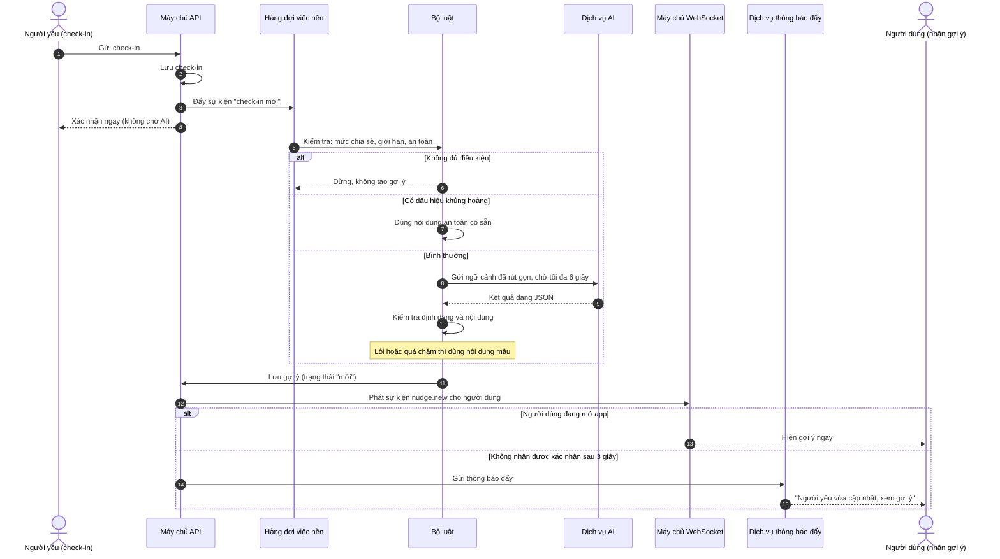
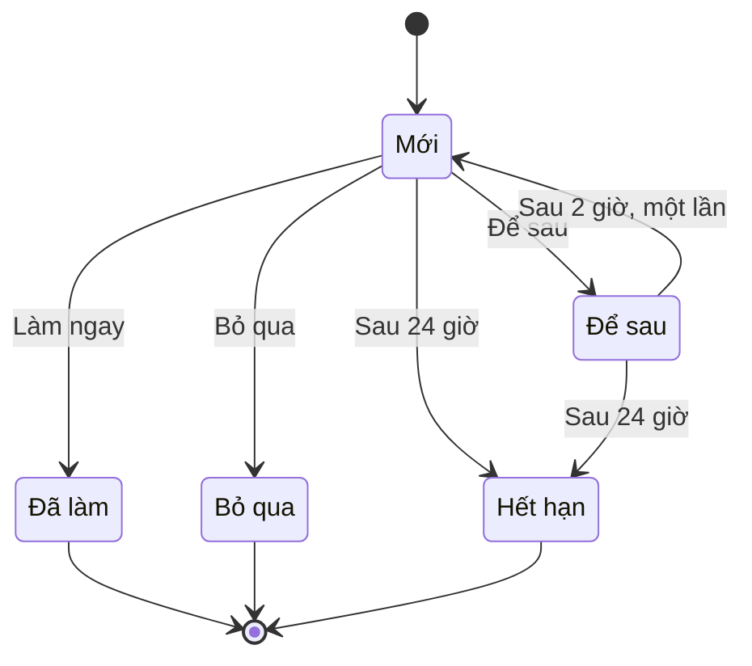

# Smart Nudge: tài liệu tính năng

## 1. Tóm tắt

Smart Nudge biến trạng thái của người yêu thành **một việc nhỏ, cụ thể mà người dùng làm được ngay**. Người yêu dùng mood check-in, hệ thống nhờ AI viết một gợi ý dựa trên các mood-checkin mà đã cấu hình sẵn (nên làm gì, bằng cách nào, nội dung soạn sẵn), rồi báo cho người dùng qua WebSocket nếu họ đang mở app, hoặc qua thông báo đẩy nếu không.

## 2. Mục đích thật sự và phục vụ được gì

**Vấn đề.** Cặp yêu xa thường gặp hai vấn đề liên tiếp: không biết người kia đang thế nào, và biết rồi vẫn không biết nên làm gì cho đúng. Phần lớn app couple chỉ giải quyết vế đầu bằng cách hiện biểu tượng tâm trạng.

**Mục đích.** Rút khoảng cách giữa "biết" và "làm" xuống còn một chạm.

**Phục vụ được những gì:**

| Phục vụ                     | Cách thực hiện                                                                                                      |
| --------------------------- | ------------------------------------------------------------------------------------------------------------------- |
| Người bận, hay quên         | Có sẵn việc để làm, không phải tự nghĩ                                                                              |
| Người ngại nói cảm xúc      | Có lời gợi ý để sửa lại, thay vì bắt đầu từ trang trắng                                                             |
| Cặp lệch múi giờ            | Gợi ý tính đến giờ bên kia (không gợi ý gọi điện lúc nửa đêm)                                                       |
| Vòng lặp của app            | Check-in của người này trở thành lý do để người kia hành động, người kia hành động thì người này có thứ để phản hồi |
| Lý do dùng app thay vì Zalo | Nhắn tin thường không biết người kia đang thế nào và không gợi ý gì                                                 |

**Không phục vụ:** thay người dùng nói lời yêu, chẩn đoán tâm lý, hay làm "cố vấn tình yêu". Smart Nudge chỉ giảm bước nghĩ và bước soạn. Người dùng vẫn là người gửi.

---

## 3. Mối quan hệ với Check-in

Smart Nudge phụ thuộc hoàn toàn vào check-in. Check-in chỉ có tâm trạng thì gợi ý chung chung, vì thế yêu cầu check-in có **lý do** và **ghi chú** là để nuôi Smart Nudge.

**Check-in cung cấp gì cho Smart Nudge:**

| Dữ liệu từ check-in           | Smart Nudge dùng thế nào                                                                           |
| ----------------------------- | -------------------------------------------------------------------------------------------------- |
| Tâm trạng (1 đến 5)           | Quyết định giọng điệu: nhẹ nhàng, động viên, hay chia vui                                          |
| Lý do (tối đa 3 tag)          | Xác định chủ đề: công việc, nhớ nhà, sức khỏe...                                                   |
| Ghi chú (≤ 140 ký tự)         | Chi tiết cụ thể để gợi ý nhắc đúng chuyện (ví dụ "nộp deadline")                                   |
| Mức chia sẻ                   | **Chỉ mình tôi**: không tạo gợi ý. **Chỉ tâm trạng**: tạo gợi ý chung, không dùng lý do và ghi chú |
| Thời điểm check-in và múi giờ | Chọn cách quan tâm hợp giờ (ghi âm hay nhắn, gọi hay không)                                        |

**Smart Nudge trả lại gì cho Check-in:** sau khi check-in xong, nếu người yêu cũng đã check-in thì màn hình chuyển thẳng sang gợi ý dành cho mình (yêu cầu 2.11), để check-in không dừng ở việc "báo cáo" mà dẫn đến hành động.

**Dữ liệu khác ngoài check-in dùng cho gợi ý:**

- "Cách tôi muốn được quan tâm" của người yêu (yêu cầu 6.4).
- 5 gợi ý gần nhất đã gửi (để không lặp) và kết quả (đã làm, bỏ qua).
- Loại quan hệ (yêu xa hay cùng thành phố).

---

## 4. Luồng hoạt động từ đầu đến cuối



**Điểm quan trọng:** API trả lời người check-in ngay, **không chờ AI**. Việc tạo gợi ý chạy nền, người check-in không bị chậm vì AI.

---

## 5. Phần nào do AI, phần nào do luật

| Việc                                   | Ai làm                     | Vì sao                                                     |
| -------------------------------------- | -------------------------- | ---------------------------------------------------------- |
| Có tạo gợi ý hay không                 | **Luật**                   | Phải chắc chắn                                             |
| Giới hạn số lượng và thời gian hết hạn | **Luật**                   | Cần kiểm soát chặt                                         |
| Phát hiện dấu hiệu khủng hoảng         | **Luật và bộ lọc từ khóa** | Sai sót ở đây nghiêm trọng nhất, không được chỉ dựa vào AI |
| Viết nội dung gợi ý                    | **AI**                     | Chỗ AI thật sự có giá trị                                  |
| Kiểm tra kết quả AI trả về             | **Luật**                   | Chặn kết quả lỗi hoặc không phù hợp                        |
| Dự phòng khi AI lỗi                    | **Nội dung mẫu**           | Người dùng không bao giờ thấy lỗi                          |

**Quy tắc sản phẩm:**

1. Mỗi lần check-in có tối đa **1 gợi ý**. Tối đa **3 gợi ý mỗi ngày** cho mỗi người.
2. Nếu gợi ý trước chưa xử lý và mới tạo chưa đến **4 giờ** thì không tạo thêm.
3. Gợi ý **hết hạn sau 24 giờ**.
4. "Để sau" nhắc lại sau **2 giờ**, chỉ một lần.
5. Nội dung người dùng gửi đi **không ghi là do AI viết**.
6. **Gợi ý chỉ hiển thị cho người nhận.** Người vừa check-in không thấy gợi ý mà người yêu của họ nhận. _(Quy tắc này chưa có trong tài liệu yêu cầu, nên thêm vào.)_

---

## 6. Triển khai mô hình AI

### 6.1 Chọn nhà cung cấp

Tiêu chí, theo thứ tự quan trọng:

1. **Viết tiếng Việt tự nhiên**, không dịch máy. Kiểm tra bằng bộ tình huống mẫu (mục 6.6), đừng chỉ tin vào bảng xếp hạng.
2. **Nhanh:** 95% gợi ý tạo xong dưới 4 giây. Thường nên dùng mô hình cỡ nhỏ đến vừa, không cần mô hình lớn nhất.
3. **Trả về đúng định dạng JSON** ổn định.
4. **Hợp đồng cam kết không dùng dữ liệu của bạn để huấn luyện**, và nêu rõ dữ liệu được xử lý ở đâu.
5. Chi phí.

Cần thử ít nhất 2 nhà cung cấp hoặc 2 cỡ mô hình trên cùng bộ tình huống mẫu rồi mới chọn.

### 6.2 Cách gọi

- **Gọi từ máy chủ, không gọi từ app.** Khóa truy cập chỉ nằm trên máy chủ.
- Đặt một **lớp trung gian** giữa nghiệp vụ và nhà cung cấp, để sau này đổi nhà cung cấp mà không sửa nghiệp vụ.
- **Thời gian chờ tối đa 6 giây.** Quá thời gian thì dùng nội dung mẫu.
- Thử lại tối đa 1 lần, và chỉ khi lỗi tạm thời, không thử lại khi đã quá 4 giây.
- **Giới hạn chi phí:** số lần gọi AI tối đa cho mỗi cặp mỗi ngày (cấu hình được).

### 6.3 Dữ liệu gửi cho AI

Gửi ít nhất có thể. **Không gửi** tên thật, số điện thoại, email, vị trí chính xác. Dùng biệt danh.

```json
{
  "nguoi_nhan_goi_y": { "biet_danh": "Linh" },
  "nguoi_yeu": {
    "biet_danh": "Nam",
    "tam_trang": 2,
    "ly_do": ["Công việc", "Căng thẳng"],
    "ghi_chu": "Mai nộp deadline",
    "gio_dia_phuong": "21:40",
    "cach_muon_duoc_quan_tam": ["Ghi âm", "Lời nói động viên"]
  },
  "loai_quan_he": "yeu_xa",
  "5_goi_y_gan_nhat": [
    { "loai": "text", "ket_qua": "da_lam" },
    { "loai": "voice", "ket_qua": "bo_qua" }
  ]
}
```

### 6.4 Hướng dẫn cho AI (khung prompt)

```
Bạn là người giúp một cặp đôi yêu xa quan tâm nhau đúng lúc.
Dựa vào thông tin dưới đây, đề xuất DUY NHẤT một việc nhỏ mà
người dùng có thể làm ngay cho người yêu.

Quy tắc:
- Viết tiếng Việt tự nhiên, thân mật, gọi người yêu bằng biệt danh.
- Việc đề xuất làm được trong dưới 2 phút.
- Nhắc đến đúng chuyện của người yêu nếu có ghi chú, không nói chung chung.
- Chọn cách quan tâm hợp giờ địa phương của người yêu và hợp sở thích của họ.
- Không chẩn đoán tâm lý, không đưa lời khuyên y tế, không hứa hẹn.
- Không dùng cùng cấu trúc câu với 5 gợi ý gần nhất.
- Nếu tâm trạng tốt: gợi ý chia vui, nhẹ nhàng hơn.
- Chỉ trả về JSON theo đúng định dạng, không thêm chữ nào khác.
```

### 6.5 Kết quả AI phải trả về

```json
{
  "observation": "Nam đang căng thẳng vì deadline ngày mai.",
  "action_type": "voice",
  "draft": "Anh cố lên nhé, em tin anh làm được. Xong việc nhớ nghỉ ngơi, em ở đây.",
  "reason": "Anh ấy đang bận, ghi âm ngắn dễ nhận hơn tin nhắn dài.",
  "tone": "supportive"
}
```

| Trường        | Giá trị cho phép                                 | Giới hạn    |
| ------------- | ------------------------------------------------ | ----------- |
| `observation` | Chữ                                              | ≤ 120 ký tự |
| `action_type` | `text`, `voice`, `photo`, `call`, `other`        |             |
| `draft`       | Chữ                                              | ≤ 280 ký tự |
| `reason`      | Chữ                                              | ≤ 100 ký tự |
| `tone`        | `gentle`, `playful`, `supportive`, `celebratory` |             |

**Kiểm tra trước khi dùng kết quả:** đúng định dạng JSON và đủ trường · không vượt giới hạn ký tự · không chứa nội dung bị cấm (từ ngữ không phù hợp, lời khuyên y tế, chẩn đoán) · `action_type` hợp lý (không gợi ý `call` nếu bên kia đang trong giờ yên tĩnh). Không đạt thì **bỏ kết quả và dùng nội dung mẫu**.

### 6.6 Nội dung dự phòng và an toàn

**Nội dung mẫu:**

- Ít nhất **60 mẫu** theo tâm trạng × lý do trước khi phát hành.
- Quản trị viên sửa được mà không cần cập nhật app.
- Dùng khi AI lỗi, quá 6 giây, hoặc kết quả không qua kiểm tra.
- Ghi nhận nguồn (`llm` hay `template`) để theo dõi tỷ lệ dùng mẫu.

**An toàn (làm ngay cả khi AI hỏng):**

- Từ khóa và bộ lọc phát hiện dấu hiệu khủng hoảng hoặc tự hại trong ghi chú, chạy **trước** khi gọi AI.
- Nếu phát hiện: **không** tạo gợi ý nhẹ nhàng thông thường. Dùng nội dung an toàn có sẵn, khuyến khích liên lạc trực tiếp, và hiện thông tin hỗ trợ khủng hoảng (quản trị viên cấu hình).
- Nội dung này, số điện thoại hỗ trợ ở Việt Nam, và cách xử lý cần được **Pháp lý và người có chuyên môn xem xét** trước khi phát hành.

### 6.7 Đánh giá chất lượng trước khi phát hành

1. Chuẩn bị bộ **ít nhất 100 tình huống mẫu** (tâm trạng × lý do × ghi chú × giờ), gồm cả tình huống khó: ghi chú mơ hồ, ghi chú dài, tâm trạng tốt, tâm trạng rất tệ.
2. Người thật chấm theo 4 tiêu chí: **đúng tông · cụ thể · tự nhiên · an toàn**.
3. Điều kiện phát hành: ít nhất **80% đạt mức "tốt"**, và **100% tình huống khủng hoảng** được xử lý đúng.
4. Sau khi phát hành, dùng nút 👍/👎 của người dùng để bổ sung tình huống mẫu.

### 6.8 Chi phí

Công thức ước tính: **số cặp × số lần check-in mỗi ngày × số gợi ý được tạo × chi phí một lần gọi AI**. Đừng ước tính bằng con số có sẵn, hãy đo bằng số lần gọi và độ dài thật trong lúc chạy thử. Các cách giảm chi phí: mức tối đa mỗi cặp mỗi ngày, dùng nội dung mẫu cho tình huống phổ biến, gửi dữ liệu ngắn gọn.

### 6.9 Quyền riêng tư

- Dữ liệu cảm xúc là dữ liệu nhạy cảm. Ghi rõ trong màn hình đồng ý rằng có dùng AI để xử lý.
- Ghi chú check-in mã hóa khi lưu. **Không ghi nội dung ghi chú vào nhật ký hệ thống.**
- Cần rà soát với Pháp lý theo Nghị định 13/2023/NĐ-CP (xem tài liệu yêu cầu, mục 6).
- Hợp đồng nhà cung cấp AI: không dùng dữ liệu để huấn luyện, nêu rõ nơi xử lý dữ liệu.

---

## 7. Thông báo đẩy

**Loại thông báo liên quan Smart Nudge** (theo bảng thông báo trong tài liệu yêu cầu):

| Mã    | Khi nào gửi                | Nội dung (chế độ thường)                     | Nội dung (chế độ riêng tư)           |
| ----- | -------------------------- | -------------------------------------------- | ------------------------------------ |
| **B** | Gợi ý mới sẵn sàng         | "Nam đang căng thẳng. Có một gợi ý cho bạn." | "Người yêu vừa cập nhật. Xem gợi ý." |
| **H** | 2 giờ sau khi bấm "Để sau" | "Bạn muốn xem lại gợi ý cho Nam không?"      | "Bạn có một gợi ý đang chờ."         |

**Quy tắc gửi** (luồng thông báo chung, tài liệu luồng chính số 9):

1. Người dùng đã tắt loại thông báo này thì không gửi.
2. **Tối đa 4 thông báo mỗi ngày.** Loại B có ưu tiên cao nhất, nên thường được giữ lại.
3. **Giờ yên tĩnh** 23:00 đến 07:00 giờ địa phương của người nhận: giữ lại đến hết giờ.
4. Gợi ý hết hạn sau 24 giờ. Nếu thông báo bị giữ lại đến lúc gợi ý hết hạn thì **hủy**, không gửi.
5. Bấm thông báo mở thẳng màn hình gợi ý đó (đường dẫn trực tiếp).
6. Không đưa ghi chú hoặc lý do chi tiết vào nội dung thông báo khi người dùng bật chế độ riêng tư.
7. Xin quyền thông báo **sau khi** người dùng check-in lần đầu.

**Khi nào dùng thông báo đẩy, khi nào dùng WebSocket:** xem mục 8.3.

---

## 8. WebSocket

WebSocket là đường kết nối giữ mở giữa app và máy chủ, để máy chủ chủ động đẩy dữ liệu xuống app ngay lập tức. Smart Nudge dùng nó để gợi ý hiện ra **ngay khi người dùng đang mở app**, không phải chờ tải lại.

### 8.1 Thiết kế kết nối

| Mục             | Đề xuất                                                                                                                  |
| --------------- | ------------------------------------------------------------------------------------------------------------------------ |
| Khi nào kết nối | Sau khi đăng nhập và khi app mở ở màn hình chính                                                                         |
| Khi nào ngắt    | Khi app xuống nền hoặc đăng xuất                                                                                         |
| Xác thực        | Gửi mã đăng nhập khi kết nối. Làm mới trước khi hết hạn.                                                                 |
| Phòng (room)    | Mỗi **người dùng** một phòng riêng (để gợi ý chỉ đến đúng người) và mỗi **cặp** một phòng chung (cho sự kiện dùng chung) |
| Giữ kết nối     | Gửi tín hiệu ping định kỳ khoảng 25 đến 30 giây                                                                          |
| Mất kết nối     | Tự nối lại, chờ lâu dần: 1, 2, 4, 8 giây, tối đa 30 giây                                                                 |
| Nhiều thiết bị  | Cho phép, mỗi thiết bị một kết nối                                                                                       |
| Mở rộng         | Khi có nhiều máy chủ WebSocket, dùng một kênh phát tin chung (ví dụ Redis) để sự kiện đến đúng máy chủ đang giữ kết nối  |

### 8.2 Sự kiện liên quan Smart Nudge

| Sự kiện           | Gửi tới                                 | Khi nào                                            | Nội dung                                                                   |
| ----------------- | --------------------------------------- | -------------------------------------------------- | -------------------------------------------------------------------------- |
| `nudge.new`       | **Chỉ người nhận** (phòng riêng của họ) | Gợi ý mới được tạo                                 | Mã gợi ý, nhận xét, loại việc, nội dung soạn sẵn, lý do, thời điểm hết hạn |
| `nudge.updated`   | Chỉ người nhận                          | Gợi ý đổi trạng thái ở thiết bị khác, hoặc hết hạn | Mã gợi ý, trạng thái mới                                                   |
| `partner.checkin` | Cả hai (phòng của cặp)                  | Có check-in mới được chia sẻ                       | Tâm trạng, lý do (theo mức chia sẻ)                                        |

**Quy tắc quan trọng:** `nudge.new` **không bao giờ** được phát vào phòng chung của cặp. Nếu làm vậy, người vừa check-in sẽ nhận được gợi ý dành cho người yêu của họ. Cần có kiểm thử cho trường hợp này.

### 8.3 WebSocket và thông báo đẩy phối hợp thế nào

| Tình huống                                          | Cách gửi                                                                                                  |
| --------------------------------------------------- | --------------------------------------------------------------------------------------------------------- |
| Người dùng đang mở app, kết nối WebSocket đang sống | Gửi `nudge.new` qua WebSocket. Nếu app xác nhận đã nhận trong **3 giây** thì **không gửi thông báo đẩy**. |
| Không có xác nhận sau 3 giây                        | Gửi thông báo đẩy (qua dịch vụ thông báo của Apple và Google)                                             |
| App đóng hoặc ở nền                                 | Chỉ gửi thông báo đẩy                                                                                     |
| Mở lại app sau khi mất kết nối                      | Gọi API lấy danh sách gợi ý chưa xử lý (không dựa vào WebSocket để lấy bù)                                |

Cách này tránh người dùng nhận cùng một gợi ý hai lần (một lần trên màn hình, một lần ở thanh thông báo).

### 8.4 Những điều cần xử lý

- **Không để sự kiện bị mất.** WebSocket không đảm bảo giao hàng. Khi kết nối lại, app luôn gọi API lấy gợi ý còn hiệu lực. Khi nhận sự kiện trùng (cùng mã gợi ý), bỏ qua.
- **Thứ tự và trạng thái.** Mỗi gợi ý có một số phiên bản tăng dần. App chỉ áp dụng sự kiện có phiên bản mới hơn bản đang có.
- **Làm đồng bộ nhiều thiết bị:** khi người dùng bấm "Làm ngay" trên điện thoại này, thiết bị còn lại nhận `nudge.updated` để không còn hiện gợi ý cũ.
- **Kiểm tra quyền ở mọi sự kiện:** chỉ người thuộc cặp mới vào được phòng của cặp, và chỉ đúng người mới vào được phòng riêng.
- **Giới hạn số lần kết nối** theo người dùng và địa chỉ IP.
- **Không đưa nội dung nhạy cảm vào nhật ký.**

---

## 9. Dữ liệu và trạng thái

**Bảng "Smart Nudge"** (đã có trong tài liệu yêu cầu, mục 7), bổ sung vài trường:

| Trường                                                    | Ý nghĩa                                  |
| --------------------------------------------------------- | ---------------------------------------- |
| Mã gợi ý, mã cặp, người nhận                              |                                          |
| Check-in nguồn                                            | Check-in nào tạo ra gợi ý này            |
| Nhận xét, loại việc, nội dung soạn sẵn, lý do, giọng điệu | Kết quả từ AI hoặc nội dung mẫu          |
| **Nguồn**                                                 | `llm` hoặc `template`                    |
| **Thời gian tạo gợi ý (ms)**                              | Để theo dõi tốc độ                       |
| **Số phiên bản**                                          | Để đồng bộ nhiều thiết bị                |
| Trạng thái                                                | Mới / Đã làm / Để sau / Bỏ qua / Hết hạn |
| Thời điểm tạo, xem, xử lý, hết hạn                        |                                          |

**Bảng "Đánh giá Smart Nudge":** mã gợi ý, 👍 hoặc 👎, lý do (sai tông, quá chung chung, không hợp lúc này, không phải kiểu của chúng tôi, khác).

**Vòng đời trạng thái:**



---

## 10. Chỉ số và cách kiểm chứng

| Chỉ số                                   | Mức tối thiểu     | Ý nghĩa                     |
| ---------------------------------------- | ----------------- | --------------------------- |
| Tỷ lệ gợi ý được thực hiện ("Làm ngay")  | Từ 15%            | Gợi ý có giá trị thật không |
| Tỷ lệ gợi ý bị đánh giá "sai tông"       | Dưới 10%          | Chất lượng nội dung         |
| 95% gợi ý tạo xong dưới                  | 4 giây            | Tốc độ                      |
| Tỷ lệ dùng nội dung mẫu thay vì AI       | Theo dõi xu hướng | Độ ổn định của AI           |
| Chi phí AI mỗi cặp mỗi ngày              | Theo dõi          | Có bền vững không           |
| Thông báo đẩy bị gửi trùng với WebSocket | Gần 0             | Phối hợp hai kênh đúng chưa |

**Kiểm chứng trước khi lập trình đầy đủ (rất khuyến nghị):**

1. Chạy thử **thủ công** với 10 đến 15 cặp yêu xa thật (ví dụ qua Zalo hoặc Telegram, người trong nhóm viết gợi ý hoặc dùng AI viết và duyệt tay).
2. So sánh hai nhóm: gợi ý do **nội dung mẫu** và gợi ý do **AI viết**. Hai nhóm này cho biết AI có thật sự làm tăng tỷ lệ người dùng làm theo không.
3. Hỏi người dùng sau 1 đến 2 tuần: "Gợi ý có khiến bạn thấy gần người yêu hơn không?"

Nếu AI không cải thiện rõ ràng so với nội dung mẫu, bản đầu có thể chỉ dùng nội dung mẫu và thêm AI sau.

---

## 11. Danh sách việc cần làm theo thứ tự

| #   | Việc                                                                                       | Ai làm                                |
| --- | ------------------------------------------------------------------------------------------ | ------------------------------------- |
| 1   | Chạy thử thủ công với người thật, so sánh nội dung mẫu và AI                               | Quản lý sản phẩm                      |
| 2   | Chọn nhà cung cấp AI, kiểm tra hợp đồng về dữ liệu                                         | Trưởng nhóm kỹ thuật, Pháp lý         |
| 3   | Viết nội dung dự phòng (60 mẫu), bộ tình huống mẫu (100 tình huống)                        | Quản lý sản phẩm, người viết nội dung |
| 4   | Xác định nội dung và thông tin hỗ trợ khủng hoảng ở Việt Nam                               | Quản lý sản phẩm, Pháp lý             |
| 5   | Dựng bộ luật (điều kiện, giới hạn, an toàn) và hàng đợi việc nền                           | Lập trình viên backend                |
| 6   | Dựng lớp trung gian gọi AI, kiểm tra kết quả, dự phòng                                     | Lập trình viên backend                |
| 7   | Dựng WebSocket (phòng riêng, phòng chung, xác nhận, kết nối lại)                           | Lập trình viên backend                |
| 8   | Dựng thông báo đẩy và cơ chế phối hợp với WebSocket                                        | Lập trình viên backend, mobile        |
| 9   | Dựng màn hình gợi ý (làm ngay, sửa, để sau, bỏ qua, 👍/👎)                                 | Lập trình viên mobile                 |
| 10  | Chấm bộ tình huống mẫu, chỉnh prompt cho đến khi đạt ngưỡng                                | Quản lý sản phẩm                      |
| 11  | Kiểm thử: gợi ý không lộ sang người check-in, không gửi trùng, kết nối lại không mất gợi ý | Người kiểm thử                        |
| 12  | Gắn sự kiện theo dõi và bảng theo dõi chỉ số                                               | Lập trình viên                        |

---

## 12. Câu hỏi cần chốt

| #   | Câu hỏi                                                                             | Ai quyết định                          |
| --- | ----------------------------------------------------------------------------------- | -------------------------------------- |
| 1   | Nhà cung cấp AI nào, đặt máy chủ ở đâu, hợp đồng có cam kết không huấn luyện không? | Trưởng nhóm kỹ thuật, Pháp lý          |
| 2   | Bản đầu dùng AI hay chỉ nội dung mẫu, dựa trên kết quả chạy thử?                    | Quản lý sản phẩm                       |
| 3   | Thông tin hỗ trợ khủng hoảng hiển thị ở Việt Nam là gì?                             | Quản lý sản phẩm, Pháp lý              |
| 4   | Thêm quy tắc "gợi ý chỉ hiện cho người nhận" vào tài liệu yêu cầu                   | Quản lý sản phẩm                       |
| 5   | Dịch vụ nào chạy WebSocket (tự dựng hay dịch vụ có sẵn)?                            | Trưởng nhóm kỹ thuật                   |
| 6   | Mức tối đa chi phí AI mỗi cặp mỗi ngày                                              | Quản lý sản phẩm, Trưởng nhóm kỹ thuật |
