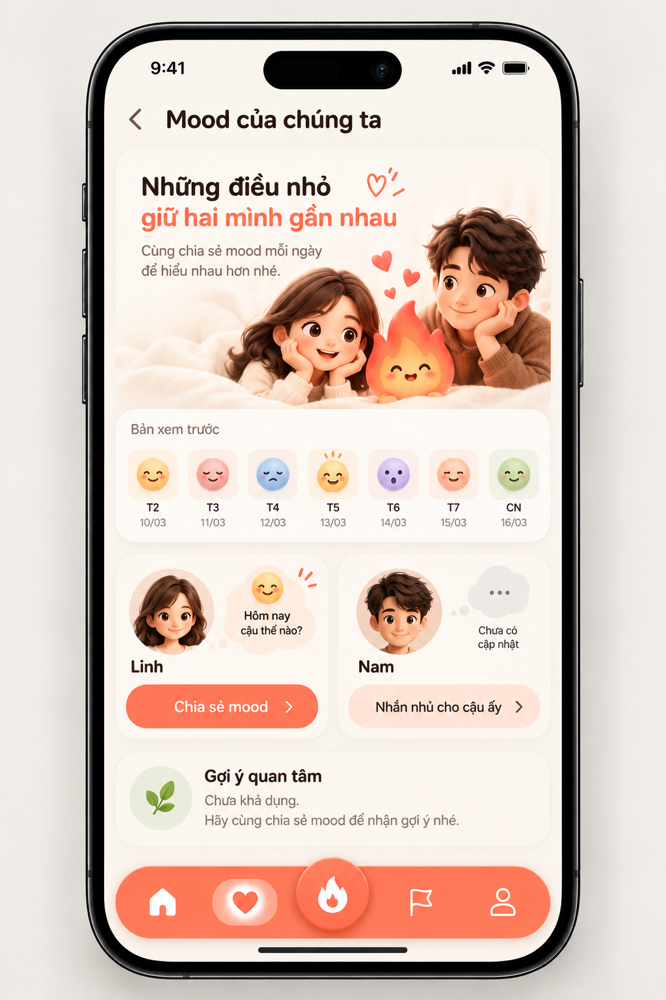
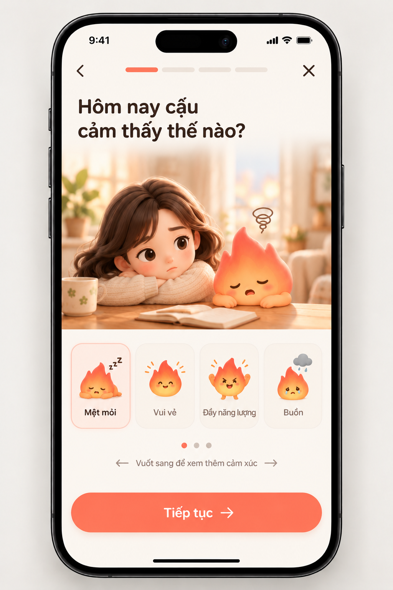
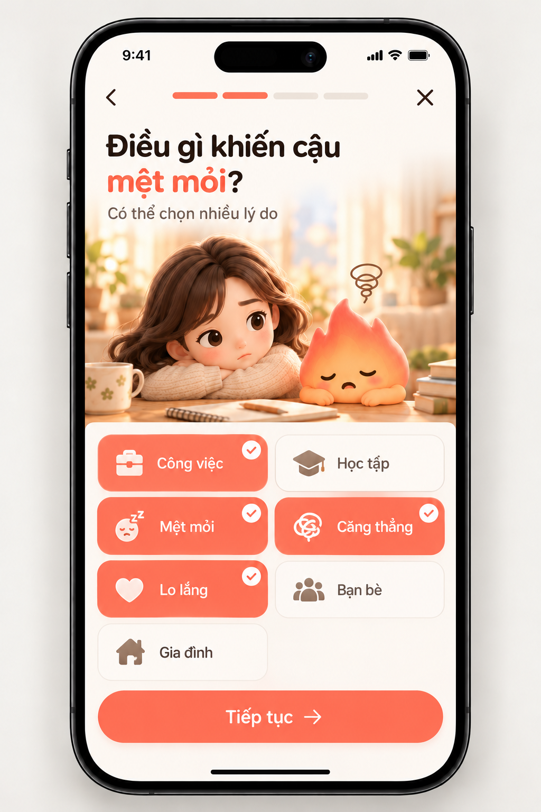
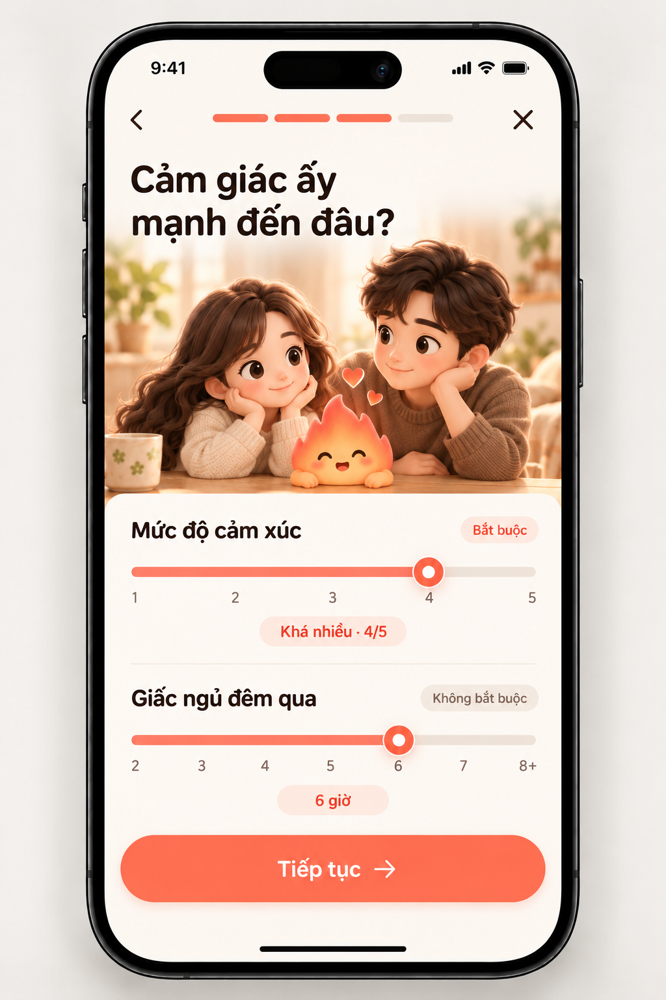
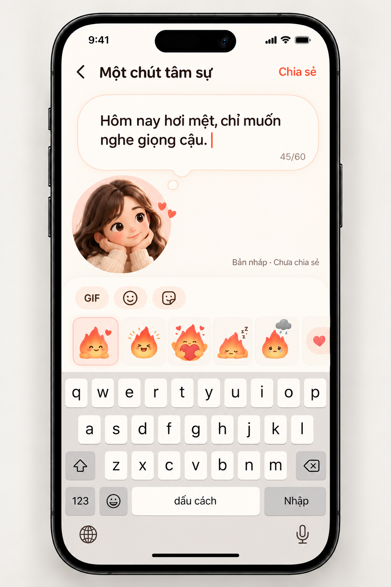
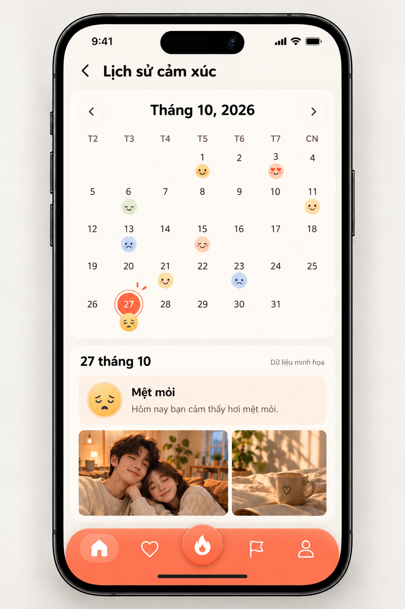
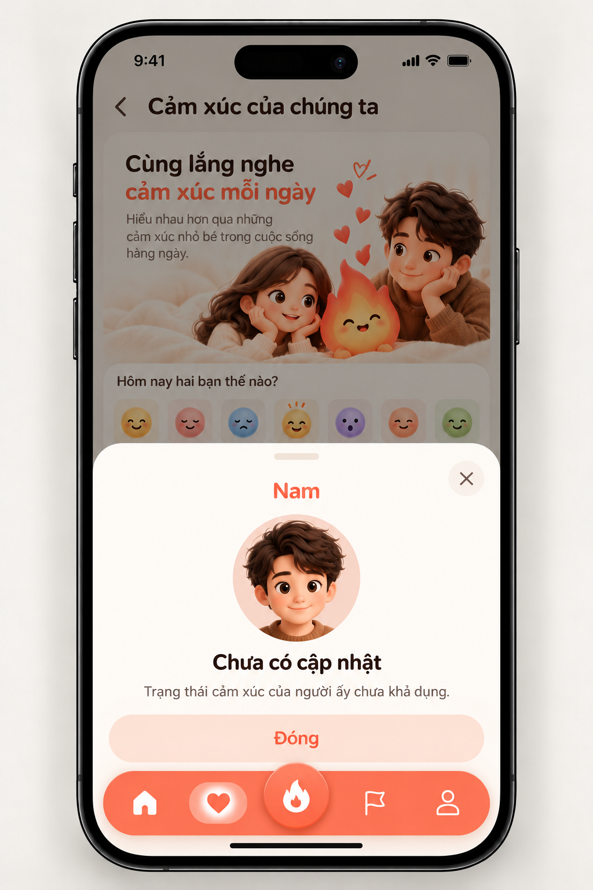

# Cảm xúc và check-in — mockup v1

Theo phong cách Tiny Mission đã duyệt. Mỗi ảnh là một màn hoặc trạng thái độc lập; đây là mockup thiết kế, không phải screenshot app hoặc bằng chứng API.

- [Mood của chúng ta](01-overview.png) — preview
- [Check-in: chọn cảm xúc](02-feeling.png) — draft
- [Check-in: lý do](03-reasons.png) — draft
- [Check-in: mức độ và giấc ngủ](04-intensity.png) — draft
- [Check-in: ghi chú](05-note.png) — draft
- [Lịch sử cảm xúc](06-history.png) — preview
- [Trạng thái người ấy](07-partner.png) — unavailable
- [Xác nhận bỏ bản nháp](08-exit-confirm.png) — draft

Prompt chung và prompt từng màn: [APP-MOCKUPS-PROMPTS.json](../../APP-MOCKUPS-PROMPTS.json). Quy chuẩn xuyên suốt: [APP-MOCKUPS-DESIGN.md](../../APP-MOCKUPS-DESIGN.md).

## Xem ảnh

### Mood của chúng ta

### Check-in: chọn cảm xúc

### Check-in: lý do

### Check-in: mức độ và giấc ngủ

### Check-in: ghi chú

### Lịch sử cảm xúc

### Trạng thái người ấy

### Xác nhận bỏ bản nháp

