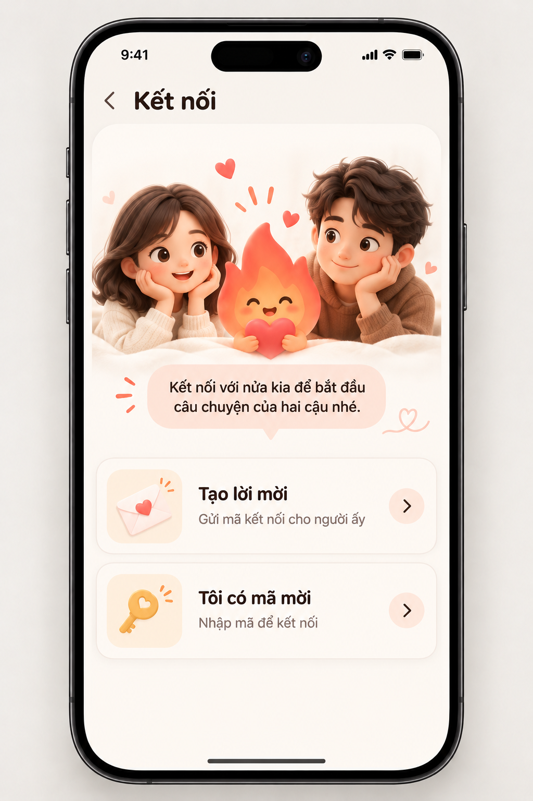
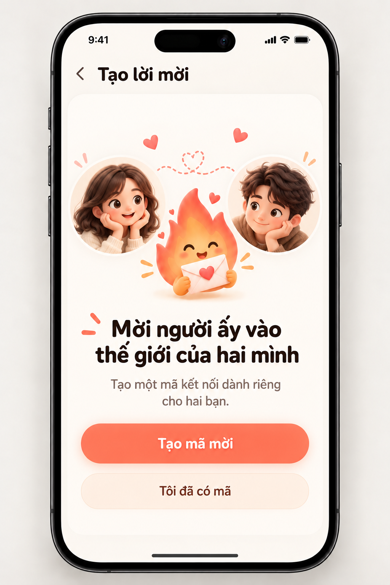
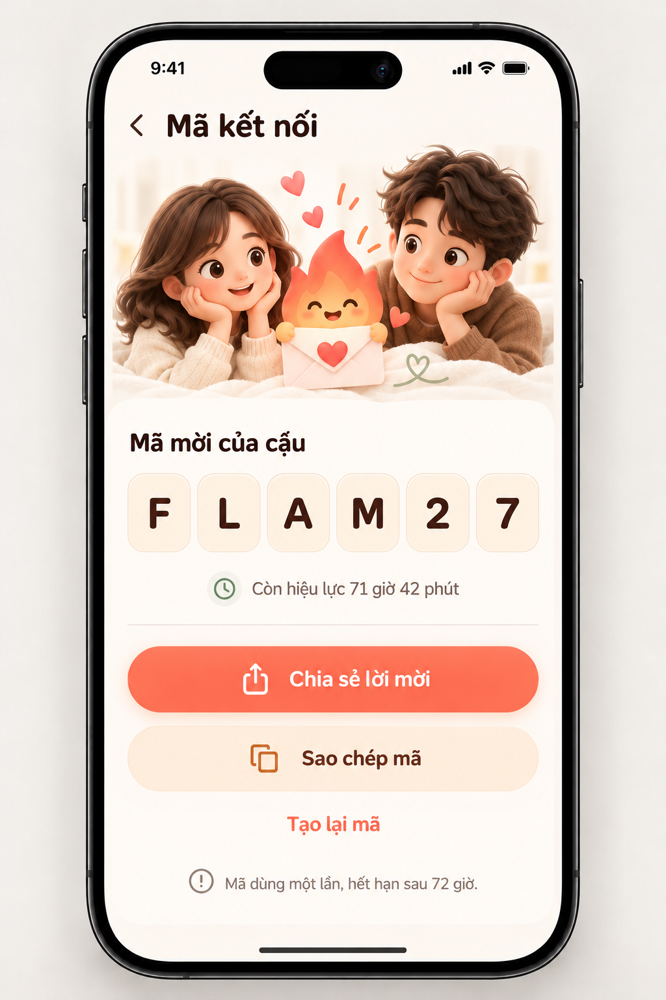
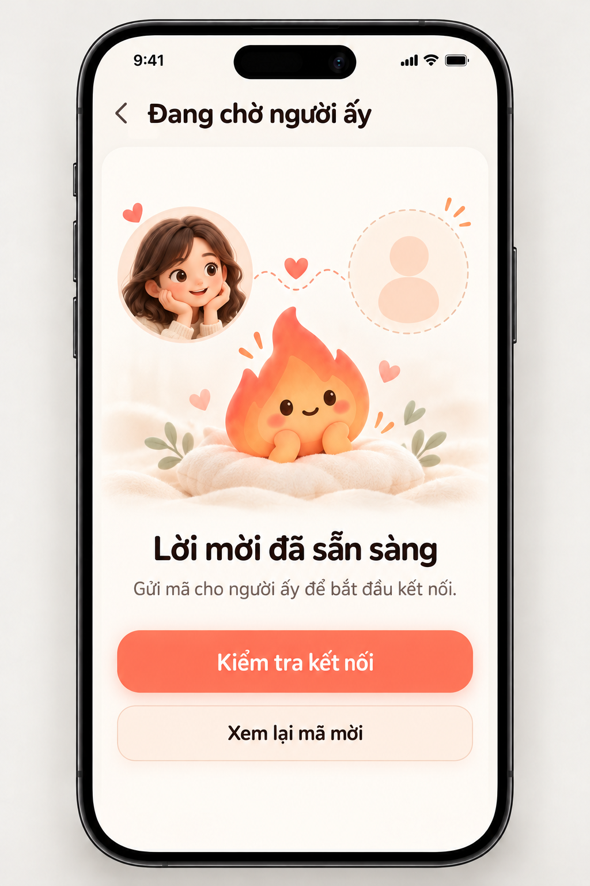
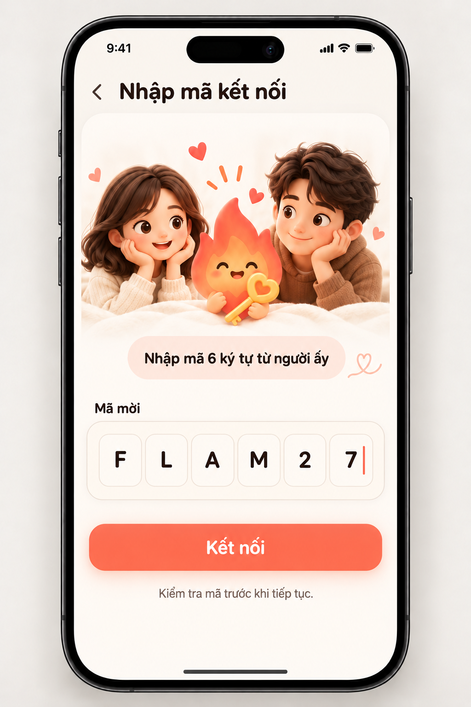
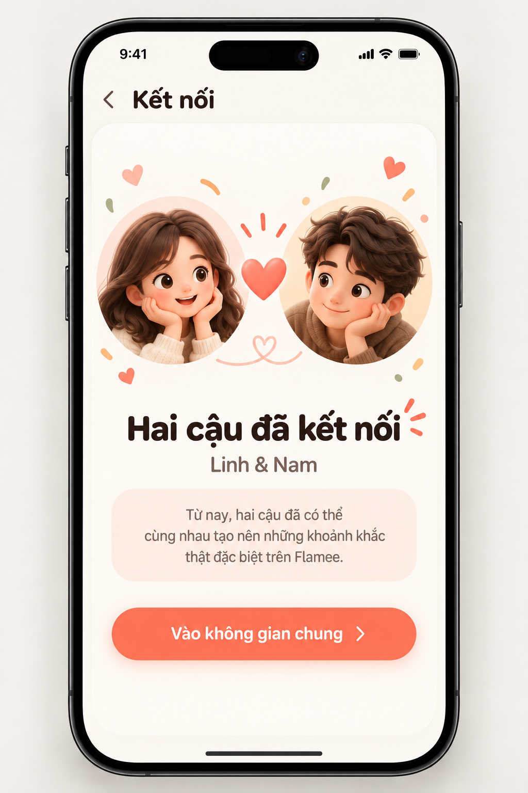
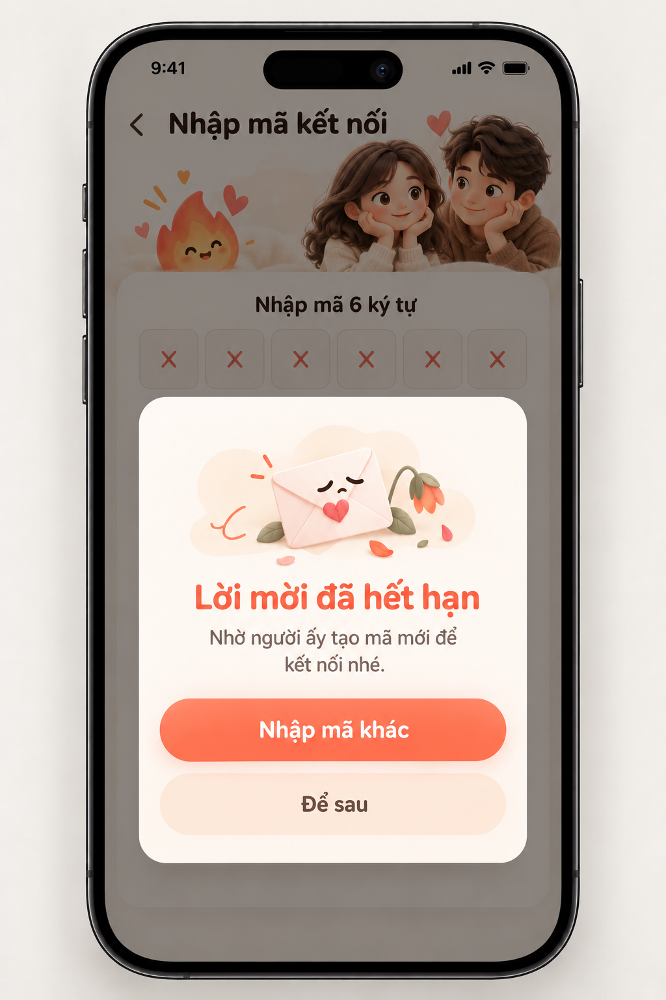

# Mời và ghép đôi — mockup v1

Theo phong cách Tiny Mission đã duyệt. Mỗi ảnh là một màn hoặc trạng thái độc lập; đây là mockup thiết kế, không phải screenshot app hoặc bằng chứng API.

- [Chọn cách kết nối](01-choose.png) — api
- [Tạo lời mời](02-create.png) — api
- [Mã mời kết nối](03-code.png) — api
- [Chờ người ấy](04-waiting.png) — api
- [Nhập mã mời](05-enter-code.png) — api
- [Ghép đôi thành công](06-connected.png) — api
- [Lời mời hết hạn](07-expired.png) — api-error

Prompt chung và prompt từng màn: [APP-MOCKUPS-PROMPTS.json](../../APP-MOCKUPS-PROMPTS.json). Quy chuẩn xuyên suốt: [APP-MOCKUPS-DESIGN.md](../../APP-MOCKUPS-DESIGN.md).

## Xem ảnh

### Chọn cách kết nối

### Tạo lời mời

### Mã mời kết nối

### Chờ người ấy

### Nhập mã mời

### Ghép đôi thành công

### Lời mời hết hạn

